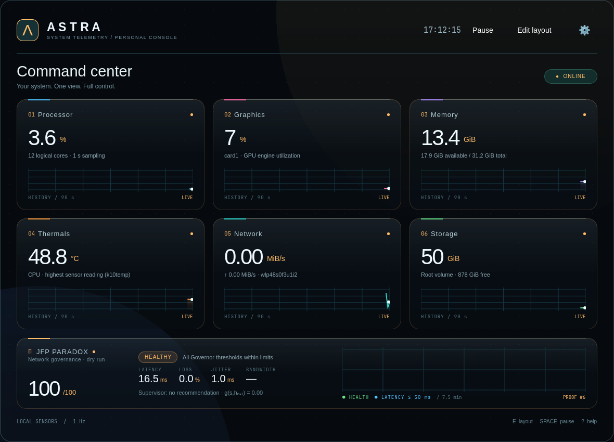

# ASTRA

Native Qt Quick system dashboard with translucent glass tiles, live Omarchy accent, Ice and Amber palettes. CPU, RAM, GPU (sysfs-compatible drivers), CPU temperature, root volume usage, and combined traffic on active network interfaces, plus a JFP Paradox network-governance strip. No accounts or services.

Build: `sh bin/build`. Test: `sh bin/test`. Run: `build/astramon`.
Package: `cd pkgbuild && makepkg -f`; install the resulting package with pacman.

On this computer the app is installed per-user at `~/.local/bin/astramon`, with its launcher and icon in `~/.local/share`. The Arch package is also available in `pkgbuild/`. System-wide installation was not completed because authentication was pending.

## JFP Paradox strip

The bottom strip embeds [JFP Paradox](https://github.com/jarohull-ai/jfp-paradox) network governance. The Governor constitution and Supervisor rules are ported 1:1 from `jfp-paradox` rust-core v0.2.0 (`src/paradox.cpp`).

- Shows network health score (0–100), state (healthy / degraded / critical), latency, packet loss, jitter, link utilisation (when the driver reports link speed), breached thresholds, the Supervisor recommendation (L2/L3) with the 3-sample streak guard, and a 7.5-minute history with two lines: health score (green, 0–100) and latency (blue, auto-scaled; the legend shows the current ceiling).
- **Dry run only:** recommended actions are displayed and logged, never executed.
- **Network probes:** every 5 s, 5 ICMP pings and one TCP connect to `8.8.8.8:443`. Change the target in `~/.config/astramon/astramon.conf` with `paradox/target=` and `paradox/tcpPort=` (e.g. your router). Pause (Space) also pauses the probes.
- **Proof chain:** state changes and recommendations go to a SHA-256 hash chain in `~/.local/state/astramon/paradox_proof.jsonl`, compatible with `jfp-paradox verify-chain`.

## Language

The UI is available in English and Polish. Pick **Settings ⚙ → Language**: *Automatic (Omarchy)* follows Omarchy's Setup › Language, or pin *English* / *Polski*. The choice is stored as `language=` in `~/.config/astramon/astramon.conf` and applies instantly. Translations live in `src/i18n/<code>.json` (English source text → translation); adding a language is one JSON file.

Use Settings to add/remove tiles and adjust opacity/colour/language. Each tile graph has its own colour (CPU blue, GPU pink, RAM violet, temperature orange, network teal, disk green). Edit layout exposes move-left, move-right and remove buttons. Settings persist in `~/.config/astramon/astramon.conf`.

| Key | Action |
| --- | --- |
| E | Edit layout |
| Space | Pause/resume readings |
| ? | Help |
| Q | Quit |

History accumulates over 90 samples; it is intentionally empty on startup. Missing sensors show an unavailable state. GPU monitoring currently requires gpu_busy_percent (typically AMD); NVIDIA NVML and Intel engine counters are not implemented. Storage measures capacity, not I/O. Network aggregates active non-loopback interfaces and may count VPN/bridge traffic twice. Backdrop blur is supplied by the compositor, not simulated in the app.

Diagnostics: `astramon --probe` outputs real sensor readings as JSON without a window. `QT_QPA_PLATFORMTHEME=basic QT_QUICK_BACKEND=software astramon --screenshot /tmp/astra.png` renders the actual UI offscreen.
